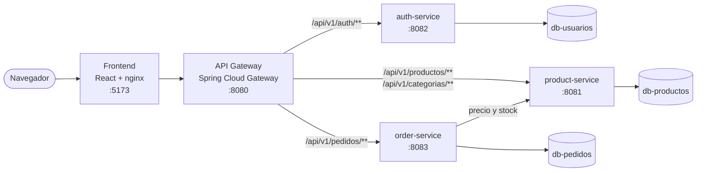
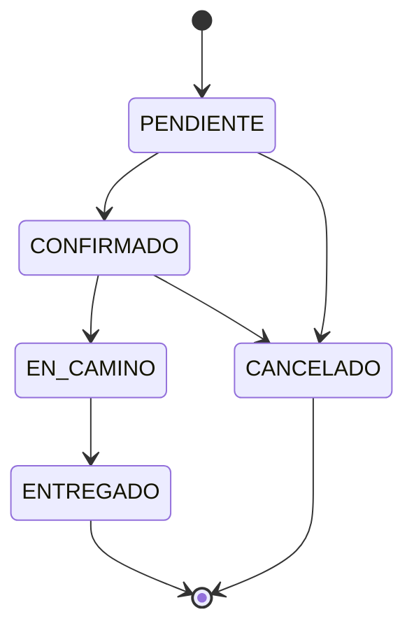
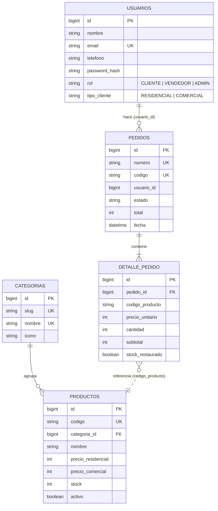

<div align="center">

# 🔥 Gas El Volcán

**Tienda web de gas licuado con arquitectura de microservicios**

Venta online de cilindros, reguladores, mangueras y accesorios, con despacho a domicilio, roles de usuario y panel de administración.


</div>

---

## 📖 Índice

1. [¿Qué es este proyecto?](#-qué-es-este-proyecto)
2. [Funcionalidades](#-funcionalidades)
3. [Arquitectura](#-arquitectura)
4. [Tecnologías](#-tecnologías)
5. [Roles y permisos](#-roles-y-permisos)
6. [API REST](#-api-rest)
7. [Modelo de datos](#-modelo-de-datos)
8. [Cómo ejecutarlo](#-cómo-ejecutarlo)
9. [Pruebas](#-pruebas)
10. [Despliegue en AWS](#-despliegue-en-aws)
11. [Estructura del repositorio](#-estructura-del-repositorio)
12. [Decisiones de diseño](#-decisiones-de-diseño)
13. [Autor](#-autor)

---

## 🧭 ¿Qué es este proyecto?

**Gas El Volcán** es una tienda web para comprar gas licuado de petróleo (GLP) y sus accesorios. Un cliente se registra, elige productos, arma su carrito y hace un pedido con despacho a su dirección. El personal de la empresa (vendedores y administradores) gestiona productos y pedidos desde un panel.

Es el **Proyecto Final** de la asignatura **DSY1104 Desarrollo Fullstack II** (Duoc UC). El sistema se compone de:

- Un **frontend** en React.
- Tres **microservicios** en Spring Boot (usuarios, productos y pedidos), cada uno con su propia base de datos.
- Un **API Gateway** que es la única puerta de entrada.
- **Docker Compose** para levantar todo con un comando, y un despliegue real en una instancia **EC2 de AWS**.

> Los datos, direcciones y sucursales de la tienda son ficticios. Es un proyecto académico.

---

## ✨ Funcionalidades

### Para el cliente
- Registro e inicio de sesión, eligiendo tipo de cuenta **Residencial** o **Comercial**.
- Catálogo con 4 categorías: Cilindros de Gas, Reguladores, Mangueras y Conexiones, y Accesorios.
- **Precio automático según el tipo de cuenta** (residencial o comercial).
- Carrito de compras y finalización de compra con dirección de entrega (casa o departamento, región y comuna).
- Boleta de la compra con número y código de orden, con opción de imprimir en PDF.
- Información de la empresa: Quiénes somos, Trabaja con nosotros, Encuéntranos, Normativas SEC y Términos y condiciones.

### Para el personal
- **Administrador:** dashboard, órdenes (con cambio de estado), productos (crear, editar, desactivar y **reactivar**), categorías, usuarios y reportes.
- **Vendedor:** consulta de órdenes y productos, solo lectura. Ve ambos precios, residencial y comercial.

### Detrás de escena
- **Autenticación con JWT** y renovación automática de la sesión.
- **Control de stock atómico:** dos compras simultáneas nunca venden la misma unidad dos veces.
- **Cancelación de pedidos** que devuelve el stock una sola vez.
- API **versionada** (`/api/v1`) y documentada con **Swagger**.

---

## 🏗 Arquitectura

El navegador solo habla con el **API Gateway**, que reenvía cada petición al microservicio correcto según la ruta. Únicamente `order-service` llama a otro servicio: consulta y descuenta stock en `product-service`.



| Componente | Puerto | Responsabilidad |
|---|---|---|
| `frontend` | 5173 | Interfaz de la tienda y del panel (React servido con nginx) |
| `api-gateway` | 8080 | Puerta de entrada única; enruta por ruta |
| `auth-service` | 8082 | Usuarios, registro, login y renovación de token |
| `product-service` | 8081 | Productos, categorías y stock |
| `order-service` | 8083 | Pedidos y su detalle |
| `db-usuarios` / `db-productos` / `db-pedidos` | 5433 / 5432 / 5434 | Una base PostgreSQL por servicio |

Cada servicio tiene su propia base de datos y ninguno lee las tablas de otro: se comunican solo por su API.

---

## 🧰 Tecnologías

| Capa | Tecnología |
|---|---|
| **Frontend** | React 19, Vite, React Router 7, Bootstrap 5, Vitest + Testing Library |
| **Backend** | Java 17, Spring Boot 4, Spring Web, Spring Data JPA, Spring Security (OAuth2 Resource Server), Bean Validation |
| **Gateway** | Spring Cloud Gateway (WebFlux) |
| **Seguridad** | JWT firmado (HS256), contraseñas con BCrypt, permisos por rol |
| **Base de datos** | PostgreSQL 16 (H2 en memoria para el perfil de desarrollo) |
| **Documentación de API** | springdoc-openapi (Swagger UI) |
| **Pruebas** | JUnit 5, Mockito, MockMvc (backend) y Vitest (frontend) |
| **Contenedores** | Docker y Docker Compose |
| **Nube** | AWS EC2 (Ubuntu 24.04) con IP elástica |

---

## 🔐 Roles y permisos

| Rol | Productos | Pedidos | Usuarios |
|---|---|---|---|
| **CLIENTE** | Solo leer | Crear y ver los suyos | Solo su perfil |
| **VENDEDOR** | Solo leer (ve ambos precios) | Ver todos, solo lectura | Sin acceso |
| **ADMIN** | Crear, editar, desactivar, reactivar | Ver todos y cambiar estado | Listar y eliminar |

**Cómo funciona la seguridad**

1. El usuario inicia sesión en `POST /api/v1/auth/login` y recibe un **token JWT** que vence a los 120 minutos.
2. El navegador envía el token en cada petición: `Authorization: Bearer <token>`.
3. **Cada servicio valida el token por sí mismo** con el mismo secreto (`JWT_SECRET`) y revisa el rol.
4. Un minuto antes de vencer, el frontend pide un token nuevo con `POST /api/v1/auth/refresh`.
5. Para tocar el stock, `order-service` usa una clave interna (`X-Internal-Key`) que un cliente normal no tiene.

Sin token la API responde **401**; con token pero sin permiso responde **403**.

### Cuentas de prueba

| Rol | Correo | Contraseña |
|---|---|---|
| ADMIN | `admin@admin.cl` | `Gasvolcan26` |
| VENDEDOR | `vendedor@volcan.cl` | `Vendedor26` |
| CLIENTE | se crea desde **Registrarse** en la tienda | la que elijas |

Son las cuentas por defecto de `.env.example`. Se pueden cambiar en el archivo `.env`.

---

## 📡 API REST

Todas las rutas van bajo `/api/v1`. Entrando por el gateway: `http://localhost:8080/api/v1/...`.

<details>
<summary><b>auth-service</b> · <code>/api/v1/auth</code></summary>

| Método | Ruta | Quién puede |
|---|---|---|
| POST | `/registro` | Público |
| POST | `/login` | Público |
| POST | `/refresh` | Autenticado |
| GET | `/perfil` | Autenticado |
| GET | `/usuarios` | ADMIN |
| DELETE | `/usuarios/{id}` | ADMIN |

</details>

<details>
<summary><b>product-service</b> · <code>/api/v1/productos</code> y <code>/api/v1/categorias</code></summary>

| Método | Ruta | Quién puede |
|---|---|---|
| GET | `/productos` | Público |
| GET | `/productos/{codigo}` | Público |
| GET | `/categorias` | Público |
| GET | `/productos/desactivados` | ADMIN |
| POST | `/productos` | ADMIN |
| PUT | `/productos/{codigo}` | ADMIN |
| DELETE | `/productos/{codigo}` (desactiva) | ADMIN |
| PUT | `/productos/{codigo}/activar` | ADMIN |
| PUT | `/productos/{codigo}/stock/descontar` | ADMIN o clave interna |
| PUT | `/productos/{codigo}/stock/aumentar` | ADMIN o clave interna |

</details>

<details>
<summary><b>order-service</b> · <code>/api/v1/pedidos</code></summary>

| Método | Ruta | Quién puede |
|---|---|---|
| POST | `/pedidos` | Autenticado |
| GET | `/pedidos/mis-pedidos` | Autenticado (solo los suyos) |
| GET | `/pedidos/{id}` | Dueño del pedido, ADMIN o VENDEDOR |
| GET | `/pedidos` | ADMIN, VENDEDOR |
| PUT | `/pedidos/{id}/estado` | ADMIN |

</details>

**Swagger UI** de cada servicio (con botón **Authorize** para probar con un token):

- Auth: `http://localhost:8082/swagger-ui.html`
- Productos: `http://localhost:8081/swagger-ui.html`
- Pedidos: `http://localhost:8083/swagger-ui.html`

### Ciclo de vida de un pedido



Un pedido solo se puede cancelar mientras está en `PENDIENTE` o `CONFIRMADO`. Al cancelar, el stock vuelve al inventario.

### Qué pasa al crear un pedido

1. El cliente envía códigos y cantidades. **No envía precios.**
2. `order-service` consulta a `product-service` el precio y el stock reales de cada producto.
3. Si falta stock, responde error y no cambia nada.
4. Elige el precio residencial o comercial según el tipo de cuenta del token.
5. Descuenta el stock en `product-service`, con una operación atómica en la base.
6. Guarda el pedido. Si falla el paso 5 o el 6, **devuelve el stock** ya descontado.

---

## 🗄 Modelo de datos

Cada servicio tiene su propia base. Las relaciones entre bases son por valor (un id o un código), no por clave foránea.



El detalle del pedido guarda una **copia del nombre y del precio** al momento de comprar, así un cambio posterior de precio no altera los pedidos antiguos.

---

## 🚀 Cómo ejecutarlo

### Requisitos

- [Docker](https://www.docker.com/products/docker-desktop/) con Docker Compose.
- (Solo para correr tests o desarrollar sin Docker) Java 17 y Node.js 20 o superior.

### Con Docker (recomendado)

```bash
# 1. Clona el repositorio y entra al proyecto
git clone https://github.com/nicorojasf/Proyecto-ElVolcan.git
cd Proyecto-ElVolcan/ProyectoFinal

# 2. Crea tu archivo de configuración
cp .env.example .env        # en Windows: copy .env.example .env
#    Edita .env y cambia DB_PASSWORD, JWT_SECRET (mínimo 32 caracteres) e INTERNAL_API_KEY

# 3. Levanta todo
docker compose up --build -d

# 4. Verifica que estén los 8 contenedores
docker compose ps
```

Luego abre **http://localhost:5173** (la tienda).

Para detener todo: `docker compose down`. Para borrar también los datos: `docker compose down -v`.

> **Si ya tenías datos de una versión anterior**, ejecuta una vez `docker compose down -v` antes de levantar. La columna `rol` de la base de usuarios se creó con una restricción que solo admitía CLIENTE y ADMIN, y no se actualiza sola al agregar VENDEDOR.

### Variables de entorno (`.env`)

| Variable | Para qué sirve |
|---|---|
| `DB_USER`, `DB_PASSWORD` | Usuario y clave de las 3 bases PostgreSQL |
| `JWT_SECRET` | Secreto con que se firma y verifica el token (mínimo 32 caracteres, igual en los 3 servicios) |
| `JWT_EXPIRATION_MINUTES` | Duración del token (por defecto 120) |
| `INTERNAL_API_KEY` | Clave que usa `order-service` para descontar stock |
| `ADMIN_EMAIL`, `ADMIN_PASSWORD` | Cuenta administrador que se crea al iniciar |
| `VENDEDOR_EMAIL`, `VENDEDOR_PASSWORD` | Cuenta vendedor que se crea al iniciar |
| `VITE_API_URL` | Dirección del gateway que usa el navegador (en AWS: `http://TU_IP:8080`) |
| `CORS_ORIGINS` | Orígenes permitidos para el frontend, separados por coma |

> ⚠️ El archivo `.env` no se sube a Git. Nunca publiques tus claves reales.

### Sin Docker (modo desarrollo)

El perfil `dev` usa H2 en memoria y claves de desarrollo ya definidas. En cada servicio:

```bash
cd "backend(microservice)/product-service"
./mvnw spring-boot:run -Dspring-boot.run.profiles=dev      # en Windows: .\mvnw.cmd ...
```

Repite para `auth-service` y `order-service`, y para el frontend:

```bash
cd "frontend(web)"
npm install
npm run dev
```

---

## 🧪 Pruebas

El proyecto tiene **125 pruebas automáticas**: 87 en el backend y 38 en el frontend.

| Componente | Pruebas | Qué verifican |
|---|---|---|
| `auth-service` | 27 | Registro, login, refresh, perfil, token JWT y permisos por rol |
| `product-service` | 25 | CRUD, desactivar y reactivar, stock y permisos |
| `order-service` | 33 | Stock, precio por tipo de cliente, estados, cancelación y permisos |
| `api-gateway` | 2 | Que cada ruta apunte al servicio correcto |
| `frontend` | 38 | Login, registro, carrito, roles del panel, renovación de sesión y productos de admin |

**Cómo correrlas**

```bash
# Backend: dentro de cada servicio
./mvnw test                 # en Windows: .\mvnw.cmd test

# Frontend
cd "frontend(web)"
npm test
```

---

## ☁️ Despliegue en AWS

El proyecto está desplegado en una instancia **EC2** de AWS Academy (Ubuntu 24.04, `t3.medium`) con una **IP elástica** para que la dirección no cambie al reiniciar.

**Puertos abiertos en el grupo de seguridad:** 22 (SSH), 5173 (tienda), 8080 (gateway) y 8081 a 8083 (Swagger de cada servicio).

**Pasos**

1. Crear la instancia EC2 e instalar Docker.
2. Asociar una IP elástica.
3. Clonar el repositorio en la instancia.
4. Ejecutar el script de despliegue:

```bash
cd Proyecto-ElVolcan/ProyectoFinal
bash desplegar-aws.sh TU_IP_ELASTICA
```

El script crea el archivo `.env` con claves aleatorias, apunta CORS y el frontend a la IP, y levanta los 8 contenedores con `docker compose up --build -d`.

---

## 📁 Estructura del repositorio

```text
Proyecto-ElVolcan/
├── Proyecto1/                 # Avance de proyectos anteriores
├── Proyecto2/
└── ProyectoFinal/             # ← Proyecto final (este README)
    ├── docker-compose.yml     # Levanta los 8 contenedores
    ├── .env.example           # Plantilla de configuración
    ├── desplegar-aws.sh       # Script de despliegue en EC2
    ├── README-DOCKER.md       # Guía rápida de Docker
    ├── frontend(web)/         # React + Vite (servido con nginx)
    │   └── src/
    │       ├── pages/         # Inicio, Catálogo, Checkout, Login, Registro, Admin...
    │       ├── components/    # Navbar, Footer, carrito, formularios, tablas
    │       ├── context/       # Sesión, carrito y notificaciones
    │       ├── services/      # api.js: todas las llamadas al backend
    │       └── __tests__/     # Pruebas con Vitest
    └── backend(microservice)/
        ├── api-gateway/       # Spring Cloud Gateway (:8080)
        ├── auth-service/      # Usuarios, login y JWT (:8082)
        ├── product-service/   # Productos, categorías y stock (:8081)
        └── order-service/     # Pedidos (:8083)
```

---

## 🧠 Decisiones de diseño

| Decisión | Por qué |
|---|---|
| **Microservicios** | Cada servicio tiene una sola responsabilidad y se prueba o cambia sin afectar a los otros. |
| **Una base por servicio** | Ningún servicio lee las tablas de otro; se hablan solo por su API. |
| **API Gateway** | El frontend conoce una sola dirección. Si cambia un puerto interno, el frontend no se entera. |
| **El gateway solo enruta** | Se mantiene simple. Cada servicio valida el token, así sigue seguro aunque alguien lo llame directo. |
| **El precio lo calcula el servidor** | El navegador se puede manipular; el servidor busca el precio real según el tipo de cuenta. |
| **Stock atómico** | El descuento es una sola operación en la base, así no se vende dos veces la misma unidad. |
| **Borrado lógico de productos** | Los pedidos antiguos los referencian; así no se pierde el historial y se pueden reactivar. |
| **Rutas `/api/v1`** | Permite cambiar la API en el futuro sin romper a los clientes antiguos. |
| **Docker Compose** | Un solo comando levanta todo igual en tu PC y en AWS. |

### Posibles mejoras

- Validar el token también en el gateway.
- Agregar HTTPS con un dominio propio.
- Integrar una pasarela de pago real.
- Usar migraciones de base de datos (Flyway) en vez de dejar que Hibernate cree las tablas.

---

## 👤 Autores

**Nicolás Rojas** · [@nicorojasf](https://github.com/nicorojasf) **Benjamin Perez**

Proyecto Final de **DSY1104 Desarrollo Fullstack II** · Duoc UC · 2026
